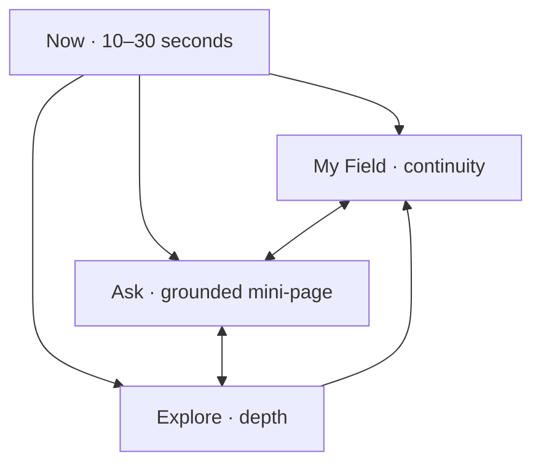

# Architecture

Flow Hijacked Android is a native-first Expo/React Native application. It reuses the canonical Flow Hijacked content and the deployed grounded Ask service without reducing the product to a WebView.

## Product topology

The four-tab shell expresses the product's 70/30 attention bias: the present moment, Recovery Field and Ask remain immediately reachable; complexity is progressively disclosed inside Explore.

## Runtime layers

| Layer | Responsibility |
|---|---|
| Expo Router screens | Android navigation, deep links, native back, first-use, low-capacity, Ask, Field, editorial reading and settings |
| Components | Recovery Field canvas, native reading shell, semantic answer sections, accessible actions and settings controls |
| Domain models | Field-state interpretation, trajectory geometry, route selection and bilingual intervention matching |
| Zustand stores | Recovery, Ask knowledge memory, reading continuity and non-sensitive settings |
| Persistence | Three isolated SQLCipher databases; random 256-bit keys stored with device-only SecureStore access |
| Network boundary | Deployed `POST /api/ask`, feedback endpoint, first-party canonical pages and link handoffs |

## Data separation

The application deliberately keeps three sensitive continuity domains apart:

| Store | Contains | Does not contain |
|---|---|---|
| Recovery | smallest returns, structured check-ins, intervention feedback | Ask questions, saved reading |
| Knowledge | opt-in Ask preferences, explored concepts/resources, explicitly saved answers | Recovery history, implicit psychological profile |
| Continuity | saved/recent content and reading position | Ask memory, Recovery Field entries |

The settings store contains only language, presentation and local-notification preferences. Android backup is disabled. Each sensitive domain has an independent deletion control.

## Recovery Field

The Field is not a score. Six display dimensions summarize a broader intervention model while the visualization communicates geometry rather than judgement:

- asymmetric 24-point boundary: available action space;
- deformation and compression: narrowed or widened options;
- solid links: selected/established relationships;
- dashed links: possible relationships;
- halo: current focus;
- trajectory: change through time.

The same state is exposed as accessible text and a short domain list. Quiet presentation and Android reduced-motion settings remove non-essential movement and relationship detail. Route selection returns at most three distinct intervention families, identifies one accessible place to begin, and preserves alternatives.

## Ask

Ask is a structured Flow Hijacked response page, not a message thread. The deployed response is schema-validated before rendering. The app exposes direct answer, mechanisms, Flow Hijacked lens, practical help, best next step, further exploration and sources.

Recovery context is off by default and granted for one answer only. The current compatibility adapter passes only explicitly consented categorical facts from this allow-list:

- sleep: `low | available`
- stress: `high | moderate`
- connection: `low | available`

It never passes Recovery history or free text, and resets consent after a successful answer. `docs/BACKEND_CONTRACT.md` specifies the production first-class context field that should replace the compatibility line.

## Explore and hybrid content

Native surfaces own navigation, reading progress, save/share, Ask/Field handoffs and Android behavior. Selected high-cost canonical experiences can render first-party content inside `HybridContent`:

- only HTTPS `flowhijacked.com` is embedded;
- different first-party routes are intercepted and returned to Expo Router;
- same-page anchors remain inside the document;
- authentication and external origins open in the system browser;
- a native title/back shell remains visible;
- cached content is preferred when the platform WebView can provide it.

Long-form native documents use `ReadingShell`, which restores precise position and records progress without generating obligations or feeds.

## Offline behavior

The navigation shell, most recent Field state, saved native reading, deterministic Here and Now entries, and explicitly saved Ask answers remain available. A new Ask request clearly requires connectivity; the application never fabricates an offline answer.

## Semantic handoffs

Handoffs preserve a bounded meaning payload instead of raw screen state:

- reading → Ask: `q`, `sourcePath`;
- reading → Field: `intent=apply`, `sourceTitle`, `sourcePath`, `prompt`;
- Ask → destination: validated type plus canonical `href`;
- Field → Ask: a framed question; optional Recovery context remains a separate one-use grant.

## Authentication boundary

The deployed website uses an HttpOnly same-origin cookie. A system-browser OAuth session cannot safely be assumed to populate a React Native networking cookie jar. Version 1 therefore does not fake signed-in sync. A production mobile session-exchange facade is defined in `docs/BACKEND_CONTRACT.md`.
